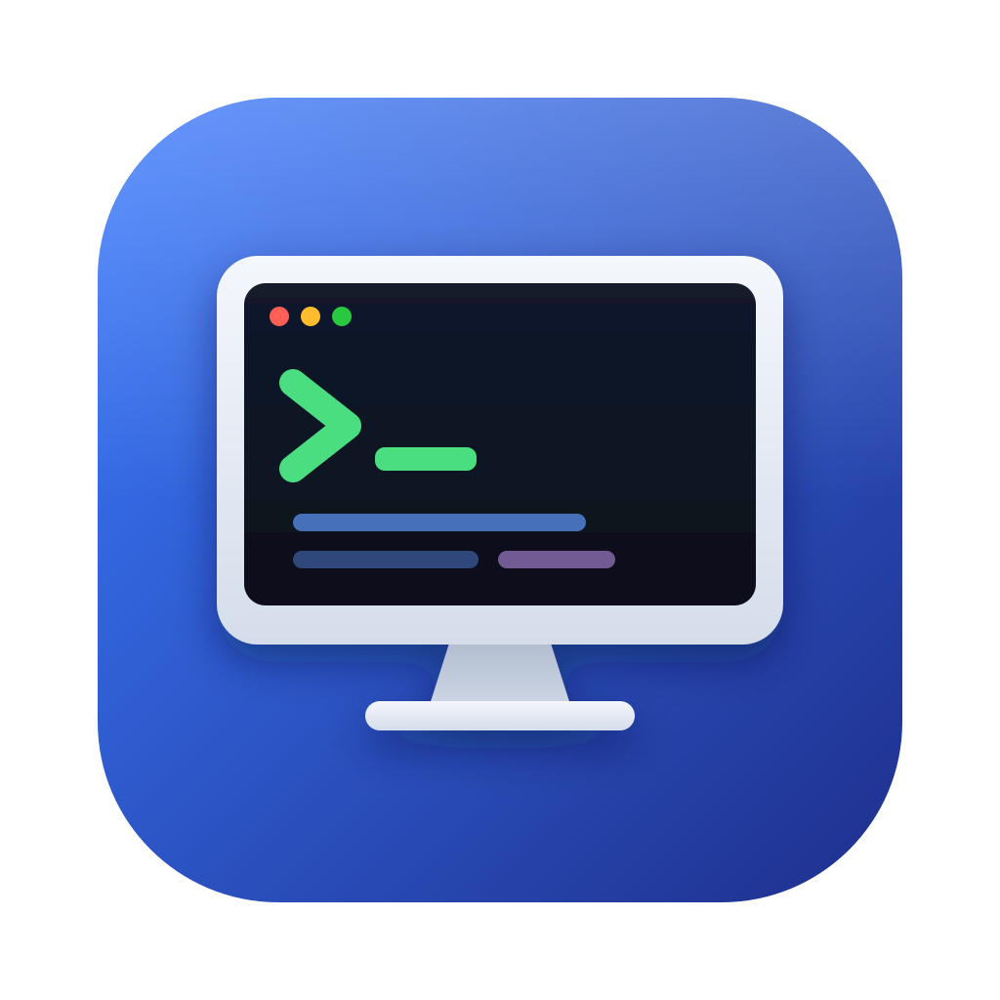

<p align="center">
  
</p>

<h1 align="center">NetTerminal para iOS</h1>

<p align="center">
  <b>Cliente móvil de terminal y herramientas de ingeniería de redes para iPhone y iPad</b><br>
  SSH · Telnet · TCP crudo · SNMP · Ping ICMP · Catálogo de comandos · Bóveda cifrada
</p>

<p align="center">
  <a href="https://github.com/Parzval-Net/Net_Terminal_IOS/releases/latest"></a>
  <a href="https://github.com/Parzval-Net/Net_Terminal_IOS/releases/latest"></a>
  <a href="https://github.com/Parzval-Net/Net_Terminal_IOS/actions/workflows/ios.yml"></a>
  <a href="https://tauri.app"></a>
  <a href="IOS.md"></a>
</p>

<p align="center">
  <a href="https://github.com/Parzval-Net/Net_Terminal_IOS/releases/latest"><b>Descargar builds iOS (simulador y .ipa sin firma)</b></a> ·
  <a href="IOS.md">Guía de Compilación e Instalación</a> ·
  <a href="https://github.com/Parzval-Net/NetTerminal_Android">Edición Android</a> ·
  <a href="https://github.com/Parzval-Net/Net_Terminal">Edición de Escritorio</a>
</p>

---

## 📱 ¿Qué es NetTerminal iOS?

**NetTerminal iOS** es el port a iPhone y iPad de NetTerminal, pensado para **ingenieros de redes, administradores de infraestructura, técnicos de telecomunicaciones y soporte de campo** que necesitan conectarse a routers, switches, firewalls y servidores desde un dispositivo Apple.

Está construido sobre un núcleo nativo en **Rust y Tauri 2 Mobile**. El protocolo SSH corre en Rust (librería russh), sin depender de una capa web para la conexión. Requiere **iOS 16 o superior** y funciona en iPhone 13 o modelos posteriores, y en iPad.

Es el hermano iOS de la [edición Android](https://github.com/Parzval-Net/NetTerminal_Android). Comparte la base de interfaz y catálogo, y se diferencia en las funciones que el sistema iOS no permite (ver la sección de limitaciones más abajo).

---

## ⚡ Características Principales

### 1. Terminal Multi-Protocolo de Campo
- **SSH nativo:** Conexión a switches, routers y firewalls con cliente SSH en Rust (russh).
- **Telnet y TCP crudo:** Acceso a consolas y servidores de terminales.
- **SNMP:** Consultas de interfaces y estado de equipos.
- **Ping ICMP nativo:** Diagnóstico de conectividad desde el propio dispositivo.

### 2. Transferencias y Servidores de Terreno
- **TFTP, FTP y HTTP:** Rescate de configuraciones y carga de imágenes de firmware.

### 3. Catálogo de Comandos Verificados
- Comandos oficiales por fabricante (Cisco, Juniper, Fortinet, Huawei, Aruba, Check Point, Linux y otros).
- Clasificación por nivel de riesgo (**Consulta, Configuración, Crítico**) con confirmación antes de enviar comandos que alteran servicio.
- Botones táctiles para **Ejecutar**, **Escribir en terminal** o **Copiar al portapapeles**.

### 4. Herramientas de Red
- **Calculadora de Subredes IPv4 e IPv6:** Máscara, wildcard, broadcast, rango de hosts y notación CIDR.

### 5. Bóveda Cifrada de Credenciales
- Contraseñas y llaves privadas cifradas con **Argon2id + XChaCha20-Poly1305**.
- Almacenadas en el espacio privado de la app. Ninguna otra aplicación del sistema puede leerlas.

---

## 🔀 Compatibilidad de Funciones: Android vs iOS

| Función | Android | iOS |
| :--- | :---: | :---: |
| SSH | ✅ | ✅ (russh nativo en Rust) |
| Telnet | ✅ | ✅ |
| TCP crudo | ✅ | ✅ |
| SNMP v1, v2c y v3 | ✅ | ✅ |
| Ping ICMP | ✅ | ✅ (ICMP nativo) |
| Traceroute | ✅ | ⏳ Pendiente |
| TFTP / FTP / HTTP | ✅ | ✅ |
| Syslog listener | ✅ (puerto 5140) | ⏳ Pendiente |
| Calculadora de subredes IPv4 / IPv6 | ✅ | ✅ |
| Speedtest | ✅ | ⏳ Pendiente |
| Topología CDP / LLDP | ✅ | ⏳ Pendiente |
| Catálogo de comandos | ✅ | ✅ |
| Bóveda cifrada (Argon2id + XChaCha20-Poly1305) | ✅ | ✅ |
| Serial USB-OTG | ✅ | ❌ |
| Shell local (PTY `/bin/sh`) | ✅ | ❌ |
| Scripts Python (`.py`) | ❌ | ❌ |

✅ Disponible · ⏳ Pendiente de validación en iOS · ❌ No disponible

---

## ⚠️ Limitaciones del Entorno iOS

| Característica | Estado en iOS | Razón Técnica y Alternativa |
| :--- | :---: | :--- |
| **Serial USB-OTG** | ❌ No disponible | iOS no expone puertos serie USB a las apps. Para consola serie, usar un servidor de terminales por red o la edición Android. |
| **Shell local (PTY)** | ❌ No disponible | iOS no permite ejecutar un shell local de sistema. Las pruebas de red se realizan contra equipos remotos. |
| **Scripts externos (`.py`)** | ❌ No disponible | iOS no permite ejecutar intérpretes ni código externo descargado. La automatización se hace con el catálogo y plantillas nativas. |
| **Conexiones en segundo plano** | ⚠️ Limitado | iOS suspende las conexiones cuando la app no está en primer plano. Para transferencias de firmware por TFTP o FTP, mantener la app abierta. |
| **Acceso a red local** | ⚠️ Requiere permiso | iOS pide permiso de red local la primera vez que la app accede a la LAN. Si se rechaza, las conexiones a equipos locales fallan. |
| **Puertos privilegiados (<1024)** | ⚠️ Puertos > 1024 | Los servicios escuchan en puertos no privilegiados, igual que en Android. |
| **Distribución** | ⚠️ Sin App Store | Las builds se distribuyen como simulador o `.ipa` sin firma. Se instalan con Xcode, AltStore o Sideloadly. Ver [IOS.md](IOS.md). |

---

## 📥 Instalación

### Opción A: Dispositivo (iPhone o iPad)
1. Descargar el `.ipa` sin firma desde la [última release](https://github.com/Parzval-Net/Net_Terminal_IOS/releases/latest).
2. Instalarlo con **AltStore**, **Sideloadly** o **Xcode** (con tu Apple ID).
3. En el dispositivo, confiar en el perfil del desarrollador si el sistema lo solicita.

La cuenta gratuita de Apple requiere volver a instalar la app cada 7 días. Detalles en [IOS.md](IOS.md).

### Opción B: Simulador de Xcode
1. Descargar el `.zip` del simulador desde la [última release](https://github.com/Parzval-Net/Net_Terminal_IOS/releases/latest).
2. Descomprimirlo y arrastrar el `.app` al simulador.

### Opción C: Compilar desde el código
```bash
npm ci
npx tauri ios dev "iPhone 17 Pro"
```

Requisitos y pasos completos en [IOS.md](IOS.md).

---

## 📄 Licencia y Créditos

- **Licencia:** Distribuido bajo la licencia MIT.
- **Autor y Desarrollador:** Nicolás Rivera ([@Parzval-Net](https://github.com/Parzval-Net)).
- **Núcleo Tecnológico:** Desarrollado con [Tauri 2 Mobile](https://tauri.app), [Rust](https://www.rust-lang.org), [russh](https://github.com/Eugeny/russh) y [xterm.js](https://xtermjs.org).
